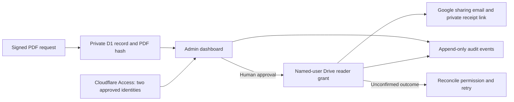

# Access workflow: deployment and operations

## Current status
**Live:** signed-PDF intake, private review dashboard, audit export and the
human-approved Drive delivery path are enabled. Sam’s actual administrator login,
Google authentication and sharing-capable access to the restricted release folder
have been verified. No applicant grant was created during testing.

Still unverified: Seán’s own sign-in, and the first genuine signed request through
approval, recipient access and receipt of Google’s sharing notification. Do not
represent the read-only connection check as proof of that complete delivery pilot.



Applicants upload their existing signed PDF; a checkbox is not a signature.
Institutional email eligibility and the agreement are manually reviewed by an
administrator. There is no automatic identity/eligibility decision. Public request
rate limits and Turnstile protect storage; no applicant email provider is needed.
New requests are reviewed in the dashboard. Drive sends its sharing notification
on new grants; an existing grant is preserved without re-sending that invitation.
The private receipt supplies the actual approved folder link after delivery.

## Resources and credentials

Use the existing Cloudflare Pages project. Bind one private D1 database as
`ACCESS_DB`, applying `migrations/0001_access.sql` to a **new, empty** database.
For an existing database, inspect schema and take a backup before migration; do
not drop/recreate records or audit tables.

Protect production `/admin*` and `/api/review/*` with the **same** Cloudflare Access
application/audience and an exact two-address allowlist for Sam and Seán. Include
the clean `/admin` route: Pages can canonicalise `.html` URLs. Existing Preview
Access settings alone do not protect production. Access's own email OTP/approved
identity provider supplies sign-in; no app passwords or frontend admin flags.

Create a dedicated Google service account with Drive API enabled, no billing
upgrade and **no project-wide Drive delegation**. It must be given sharing-capable
access only to the approved release folder. For a personal Drive folder this
requires a write-capable role, which also permits content edits: obtain explicit
owner approval for that boundary. The application itself only lists metadata and
creates named-user reader permissions. Do not share the raw archive or a personal
Drive root with this identity. Store its key only in Cloudflare Secrets. `GOOGLE_PRIVATE_KEY` accepts either
the complete original Google service-account JSON or its PEM private-key value.
For JSON input, the `client_email` must exactly match `GOOGLE_CLIENT_EMAIL`; the
JSON cannot change the configured service identity. Never
paste credentials into Git, deployment ZIPs, chat, screenshots or command flags.

Confirm the configured folder is the intended consented split-video/landmark
release. Sharing a folder includes current/future children; maintain that folder
as a controlled release. `RELEASE_ID` labels the reviewed scope; the application
does not turn a mutable folder into an immutable snapshot.

## Runtime configuration

| Binding/variable | Purpose |
| --- | --- |
| `ACCESS_DB` | Private D1 binding with the migration applied |
| `PUBLIC_ORIGIN` | Exact production origin, without trailing slash |
| `ACCESS_ISSUER` | `https://<team>.cloudflareaccess.com` |
| `ACCESS_AUDIENCE` | Audience of the private admin application |
| `APPROVER_EMAILS` | Exact comma-separated Sam/Seán addresses, server-side only |
| `RELEASE_ID` | Approved release version label |
| `DRIVE_FOLDER_ID` | Only the approved consented release folder |
| `GOOGLE_CLIENT_EMAIL` | Restricted Google service identity |
| `GOOGLE_PRIVATE_KEY` | Encrypted original Google JSON or extracted PKCS8 PEM; never source |
| `TURNSTILE_SITE_KEY` | Production widget restricted to the website hostname |
| `TURNSTILE_SECRET_KEY` | Secret for server-side Siteverify |
| `INTAKE_RATE_SECRET` | Secret random 32+ bytes, used for receipt/rate protection |
| `SCOPE_CONFIRMED` | `true` only after the owner checks release scope |
| `DELIVERY_ENABLED` | `false` until real credentials and sharing scope verified |
| `REQUESTS_ENABLED` | `false` until private review and delivery are ready |

All activation flags default closed. No real applicant data is accepted while
prerequisites are missing. The 20 public examples remain independent of these
flags and cannot grant Drive access.

The unsigned official EULA snapshot is public, byte-for-byte preserved, pinned in
`config/agreement.json`. Uploaded signed copies are private database BLOBs with
separate SHA-256. To change the official version, import the authorised new PDF,
update version/hash/URL and rebuild. Old-version approvals stop under the new
policy. Do not silently edit terms or claim to verify signatures automatically.

## Build and package

```bash
npm ci
npm test
npm run build:worker
python scripts/package_public_portal.py --source /path/to/verified-web-v1 --out dist
```

The Worker build is bundled once; deployment has no Node/npm runtime dependency.
The package verifies the bundle and every source input hash before including it.
Only declared public files, blank EULA and the 20 approved sample payloads are
packaged. No private request records, signed PDFs, migrations, fixtures or keys.

## Verification and activation order

1. Apply the private database schema; configure Access and bot protection.
2. Enter secrets directly in the service. Keep both activation flags false.
3. Sign into the admin page as each real authorised identity. Confirm that an
   anonymous caller and another signed identity cannot list requests or PDFs.
4. Confirm the service account can share only the intended release scope. Do not
   test by making the dataset public or inviting a fake external email.
5. Enable delivery and requests deliberately; run one genuine owner-approved
   pilot. The human reviewer must check its signed PDF and institutional identity.
6. Verify Google permission ID, recipient, reader role, expected folder, sharing
   notification and private receipt. Record pilot evidence without exposing data.

Creation of a Google permission is confirmed; inbox receipt is not guaranteed by
an HTTP success. A failed or ambiguous operation is recorded for reconciliation.
Changing a recipient requires a new reviewed request; there is no edit-and-switch
path after approval. Approved deliveries are serialised per release. An expired
claim can be recovered after five minutes; external calls have shorter deadlines.

## Audit, privacy and recovery

Audit records capture claimed applicant vs authenticated administrator identity,
UTC time, signed-file and agreement hashes, review note/checks, release, attempts,
permission ID, preserved existing grants, failures, retries and document/export
access. SQL triggers reject audit edits/deletes and changes to request identity or
evidence. The audit export paginates a fixed ID snapshot; no silent history cutoff.
Database/account owners can still change infrastructure, so this is **not** WORM
storage or a claim of tamper-proof non-repudiation. Keep controlled external audit
backups as required by the institution; no copies belong in this public repository.

Signed PDFs are served only to authenticated administrators as no-store attachment
downloads and checked against stored hashes. Receipt tokens expose status and,
only after delivery, the approved Drive link; actual access still requires the
recipient's Google identity. No raw IP is stored; daily rate buckets use a secret
salt. The initial cap is 250 stored requests / 1 MB each, not an unlimited archive.
Plan retention and export privately before raising that cap.

Pausing intake does not revoke existing Drive grants. Removing a Drive permission
must be a separate explicitly authorised operation; this workflow never deletes
or downgrades pre-existing access. Already-downloaded data cannot be recalled.

## Safe local demonstration

```bash
npm run dev:access
```

Open http://127.0.0.1:8770/request.html and `/admin.html`. The loopback-only helper
uses in-memory SQLite, ephemeral fixture keys and simulated external responses.
It never calls Google or sends emails and is not bundled/deployed. Use fixture
identities/documents only. It deliberately auto-authenticates a **local fixture**
administrator to exercise the UI; production has no such bypass.

## Production verification — 20 November 2026

- Deployment: `f32d778c-b961-40ce-a763-72bbbb4b6b58`, source implementation
  `4f0c480`; 907 allowlisted public files, including all 20 approved examples.
- Archive SHA-256: `bfe0d9f2d304673b19e6e6cadc521497d08f8acfbcbe8f4f2c6e07202d336622`.
- `REQUESTS_ENABLED`, `DELIVERY_ENABLED` and `SCOPE_CONFIRMED` are enabled.
- D1 has the four application tables, status index and all three audit/evidence
  triggers. The Google service identity has no project roles or domain delegation;
  its only assigned Drive scope is the approved release folder, with Editor rights.
- Real admin login is verified for Sam. The private connection check confirms
  Google authentication, the expected folder, sharing capability, restricted ACL
  and service role `writer`, with `permissionsChanged: false`.
- The public request form renders with signed-PDF fields, identity/purpose fields,
  explicit manual review and a successful production Turnstile check. The widget
  permits only `qub-pheo.pages.dev`, with managed mode and no pre-clearance.
- Audit export was downloaded from real D1 and verified. Setup failures and
  successful connection checks are attributed to the authenticated administrator;
  no applicant decisions or grants were created as tests.
- The direct deployment URL rejects review API requests without an Access JWT,
  even in a browser signed into the production website. Public samples remain
  independent of the private review API.
- Local verification: **46 passing tests**, plus successful Worker build and
  checksum verification of every deployment entry. No secrets, signed applicant
  documents, videos, landmarks or private records entered Git.

The first live sign-in exposed a Workers runtime difference: `redirect: 'error'`
is unsupported. JWKS, Google and Turnstile calls now use `manual` and reject
redirect responses. The adapter preserves the native fetch calling convention.
Safe phase codes identify configuration/network failures without exposing secrets.
The private key accepts original Google JSON only for the exact configured
service email, or its quoted/plain PEM; the owner corrected the saved value and
the subsequent live connection check passed. No key was read back by the agent.

To pause safely, set `REQUESTS_ENABLED=false` (and, if required,
`DELIVERY_ENABLED=false`) and redeploy the verified full package. This does not
revoke existing Drive grants. Re-enable only after the read-only connection check
passes. New requests appear in the admin dashboard; this version does not send
separate pending-request alert emails. Google sends invitations for new approved
grants, and applicants can retain their private receipt URL.

## Historical EULA archive

The private dashboard now separates **Historical records** from new requests.
Apply `migrations/0002_historical_records.sql` to an existing v1 database before
deploying this version; this is additive and preserves live requests/audit rows.
Fresh setups apply both migrations in filename order. The archive stores original
PDF bytes, filename/hash, known form date, reported approver/sharer, source notes
and actual authenticated importer/time. Missing contacts and event dates stay
null. An imported record is not evidence of a new signed-JWT approval or Drive
permission, and it has no approve/deliver/retry action. Reimporting the same file
cannot duplicate or silently overwrite its attribution. History is immutable;
corrections need separately recorded evidence.

The combined live/historical document cap is 250, with at most 1 MB per PDF.
Historical PDFs use the same private D1 storage and no-store download protections.
Audit entries link through `historicalId` in details, keeping the original live
request foreign-key contract intact. The importer’s authenticated identity is
recorded separately from the reported past approver and data sharer.

Verified historical deployment: `fdb5d57f-366c-4737-8147-beca85d8a73e`, source
`4e55989`, 907 entries; archive SHA-256
`69740cf41d556f903a543b6d94d56efedfd9a87411e3be73be5a756a1a5d83f1`.
Four user-authorised originals are stored privately; all four download checksums
and attribution fields match the private manifest. The live audit export confirms
four archive imports and four downloads, with no new approval/grant events.
Public intake remains active and unauthenticated deployment-alias archive API
access is rejected. 52 tests pass; the real archived records and signed forms are
not shipped in source or the public deployment package.

### Supplementary historical contacts

Select a historical record and use **Reported contact addresses** to record
institutional and alternate emails with their source. This appends a
`historical_contacts_recorded` audit event; it never changes the immutable
original record/PDF or calls Google. The dashboard shows the latest annotation
and its authenticated recorder/time while retaining the original unknown contact
field. Earlier annotations remain in audit exports. Identical sequential saves
are idempotent. These addresses do not establish mailbox ownership or identify
the account that historically received Drive access.

Verified deployment: `1b458d0c-bb16-460e-aca2-9efde3546d17`, source `e252450`,
907 entries, archive SHA-256
`b5f3d5a4f52e2b9771732e8bf0d800f5bfbac7a711b8e90fdb1d0b015be005c6`.
Seven supplied addresses on four historical records were checked against the
live UI and four attributed audit entries (snapshot 44). Original PDF hashes
remain unchanged; no new approval, invitation or permission grant was made.
54 tests pass. Applicant contact values are private and excluded from this repo.
