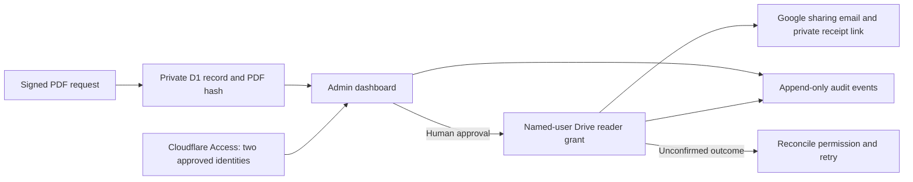

# Access workflow: deployment and operations

## Current status
Implemented, locally verified and **deployed with intake/delivery disabled**.
The private D1 schema/binding, two-person Access app and restricted Google service
identity have been created with Sam’s explicit approval. Existing email handling
remains the fallback. Do not claim unattended delivery until an actual approved
pilot confirms reviewer sign-in, the correct Drive ACL and notification.



Applicants upload their existing signed PDF; a checkbox is not a signature.
Institutional email eligibility and the agreement are manually reviewed by an
administrator. There is no automatic identity/eligibility decision. Public request
rate limits and Turnstile protect storage; no applicant email provider is needed.
New requests are reviewed in the dashboard. Drive sends its sharing notification
on new grants; an existing grant is preserved without re-sending that invitation.
The private receipt supplies the actual approved folder link after delivery.

## Resources and credentials

Use the existing Cloudflare Pages project. Bind one private D1 database as
`ACCESS_DB`, applying `migrations/0001_access.sql` to a **new, empty** database.
For an existing database, inspect schema and take a backup before migration; do
not drop/recreate records or audit tables.

Protect production `/admin*` and `/api/review/*` with the **same** Cloudflare Access
application/audience and an exact two-address allowlist for Sam and Seán. Include
the clean `/admin` route: Pages can canonicalise `.html` URLs. Existing Preview
Access settings alone do not protect production. Access's own email OTP/approved
identity provider supplies sign-in; no app passwords or frontend admin flags.

Create a dedicated Google service account with Drive API enabled, no billing
upgrade and **no project-wide Drive delegation**. It must be given sharing-capable
access only to the approved release folder. For a personal Drive folder this
requires a write-capable role, which also permits content edits: obtain explicit
owner approval for that boundary. The application itself only lists metadata and
creates named-user reader permissions. Do not share the raw archive or a personal
Drive root with this identity. Store its key only in Cloudflare Secrets. `GOOGLE_PRIVATE_KEY` accepts either
the complete original Google service-account JSON or its PEM private-key value.
For JSON input, the `client_email` must exactly match `GOOGLE_CLIENT_EMAIL`; the
JSON cannot change the configured service identity. Never
paste credentials into Git, deployment ZIPs, chat, screenshots or command flags.

Confirm the configured folder is the intended consented split-video/landmark
release. Sharing a folder includes current/future children; maintain that folder
as a controlled release. `RELEASE_ID` labels the reviewed scope; the application
does not turn a mutable folder into an immutable snapshot.

## Runtime configuration

| Binding/variable | Purpose |
| --- | --- |
| `ACCESS_DB` | Private D1 binding with the migration applied |
| `PUBLIC_ORIGIN` | Exact production origin, without trailing slash |
| `ACCESS_ISSUER` | `https://<team>.cloudflareaccess.com` |
| `ACCESS_AUDIENCE` | Audience of the private admin application |
| `APPROVER_EMAILS` | Exact comma-separated Sam/Seán addresses, server-side only |
| `RELEASE_ID` | Approved release version label |
| `DRIVE_FOLDER_ID` | Only the approved consented release folder |
| `GOOGLE_CLIENT_EMAIL` | Restricted Google service identity |
| `GOOGLE_PRIVATE_KEY` | Encrypted original Google JSON or extracted PKCS8 PEM; never source |
| `TURNSTILE_SITE_KEY` | Production widget restricted to the website hostname |
| `TURNSTILE_SECRET_KEY` | Secret for server-side Siteverify |
| `INTAKE_RATE_SECRET` | Secret random 32+ bytes, used for receipt/rate protection |
| `SCOPE_CONFIRMED` | `true` only after the owner checks release scope |
| `DELIVERY_ENABLED` | `false` until real credentials and sharing scope verified |
| `REQUESTS_ENABLED` | `false` until private review and delivery are ready |

All activation flags default closed. No real applicant data is accepted while
prerequisites are missing. The 20 public examples remain independent of these
flags and cannot grant Drive access.

The unsigned official EULA snapshot is public, byte-for-byte preserved, pinned in
`config/agreement.json`. Uploaded signed copies are private database BLOBs with
separate SHA-256. To change the official version, import the authorised new PDF,
update version/hash/URL and rebuild. Old-version approvals stop under the new
policy. Do not silently edit terms or claim to verify signatures automatically.

## Build and package

```bash
npm ci
npm test
npm run build:worker
python scripts/package_public_portal.py --source /path/to/verified-web-v1 --out dist
```

The Worker build is bundled once; deployment has no Node/npm runtime dependency.
The package verifies the bundle and every source input hash before including it.
Only declared public files, blank EULA and the 20 approved sample payloads are
packaged. No private request records, signed PDFs, migrations, fixtures or keys.

## Verification and activation order

1. Apply the private database schema; configure Access and bot protection.
2. Enter secrets directly in the service. Keep both activation flags false.
3. Sign into the admin page as each real authorised identity. Confirm that an
   anonymous caller and another signed identity cannot list requests or PDFs.
4. Confirm the service account can share only the intended release scope. Do not
   test by making the dataset public or inviting a fake external email.
5. Enable delivery and requests deliberately; run one genuine owner-approved
   pilot. The human reviewer must check its signed PDF and institutional identity.
6. Verify Google permission ID, recipient, reader role, expected folder, sharing
   notification and private receipt. Record pilot evidence without exposing data.

Creation of a Google permission is confirmed; inbox receipt is not guaranteed by
an HTTP success. A failed or ambiguous operation is recorded for reconciliation.
Changing a recipient requires a new reviewed request; there is no edit-and-switch
path after approval. Approved deliveries are serialised per release. An expired
claim can be recovered after five minutes; external calls have shorter deadlines.

## Audit, privacy and recovery

Audit records capture claimed applicant vs authenticated administrator identity,
UTC time, signed-file and agreement hashes, review note/checks, release, attempts,
permission ID, preserved existing grants, failures, retries and document/export
access. SQL triggers reject audit edits/deletes and changes to request identity or
evidence. The audit export paginates a fixed ID snapshot; no silent history cutoff.
Database/account owners can still change infrastructure, so this is **not** WORM
storage or a claim of tamper-proof non-repudiation. Keep controlled external audit
backups as required by the institution; no copies belong in this public repository.

Signed PDFs are served only to authenticated administrators as no-store attachment
downloads and checked against stored hashes. Receipt tokens expose status and,
only after delivery, the approved Drive link; actual access still requires the
recipient's Google identity. No raw IP is stored; daily rate buckets use a secret
salt. The initial cap is 250 stored requests / 1 MB each, not an unlimited archive.
Plan retention and export privately before raising that cap.

Pausing intake does not revoke existing Drive grants. Removing a Drive permission
must be a separate explicitly authorised operation; this workflow never deletes
or downgrades pre-existing access. Already-downloaded data cannot be recalled.

## Safe local demonstration

```bash
npm run dev:access
```

Open http://127.0.0.1:8770/request.html and `/admin.html`. The loopback-only helper
uses in-memory SQLite, ephemeral fixture keys and simulated external responses.
It never calls Google or sends emails and is not bundled/deployed. Use fixture
identities/documents only. It deliberately auto-authenticates a **local fixture**
administrator to exercise the UI; production has no such bypass.

## Setup checkpoint — 20 November 2026

Production deployment `da966974-378c-49f8-9837-e8b93149e1bc` contains the
verified 907-file package from source commit `66f4ffd`. All 20 approved examples
remain included. The live config reports intake disabled; `/request` presents the
email fallback. Anonymous `/admin` and `/api/review/requests` reach the Access
sign-in gate. The configured allowlist has exactly the two nominated reviewers.

A new empty D1 database now contains the four application tables, status index
and all three evidence/audit triggers. It is bound as `ACCESS_DB`. The dedicated
Google service account was created in the existing research Drive API project
with no project roles or domain-wide delegation, and added as Editor to only
the approved release folder. Drive's general link remains Restricted; existing
collaborator permissions were preserved. The Drive API was already enabled.

Remaining setup: the owner must create and enter `GOOGLE_PRIVATE_KEY` directly
in Cloudflare Secrets. The credential creation dialog and correctly named Secret
field were left ready for the owner. No service key has been created by the agent.
A fresh Turnstile widget is still required: the current dashboard form reports
“No results” and does not add the valid custom `qub-pheo.pages.dev` hostname. No
other widget was reused, no extra hostname added, and bot verification was not
removed. `TURNSTILE_SITE_KEY`, `TURNSTILE_SECRET_KEY` and `INTAKE_RATE_SECRET` remain
unconfigured. Both activation flags remain false. Changing settings requires a
new deployment before runtime validation.

Live sign-in by both administrators and a genuine reviewed delivery pilot remain
unverified. No applicant was invited or used as a test. Provider resource details
and private setup evidence are recorded outside this public repository.

### Credential and bot protection follow-up
Sam confirms the Google private key is saved; the dashboard shows it as an
encrypted Secret, without reading it back. A dedicated managed Turnstile widget
was created using Cloudflare’s Spin dialog to avoid the broken manual custom-host
entry. Its automatic local hostnames were then removed; only
`qub-pheo.pages.dev` is authorised, with pre-clearance disabled. Its secret and
a fresh 32-byte receipt/rate secret were stored encrypted, and its public sitekey
was added to production configuration. No secrets enter source or artifacts.

The admin dashboard now has **Check Drive connection**. This authenticated,
same-origin operation checks Google authentication, the configured folder’s
sharing capability and its ACL without creating/changing permissions. Results
and safe failure codes are audited. It works with delivery disabled. Re-run it
after key rotation or release-folder maintenance; broad-sharing warnings require
owner investigation. A successful check does not prove notification delivery.

The updated suite has 41 passing tests, including private diagnostic access,
paused-delivery checks, ACL pagination and safe external failure reporting. A
real admin login is still needed to run this check against production credentials.

Production follow-up deployment: `def18a57-e614-4885-8929-ab5be6e41ff9` from
source `c40015c`, with the saved encrypted Google key, Turnstile settings and
receipt/rate salt. All 907 package entries verified (SHA-256
`fb8d86d807665c1dea58066f86dede15932a438af7022fb881bd443fff651cc5`).
Anonymous access to the new diagnostic reaches the Access gate. Live public
config still reports disabled intake. Sam’s one-time-PIN login is pending;
therefore encrypted-key presence is verified, but actual Google authentication
and the live private diagnostic are not yet claimed successful.

### Live authentication findings
Sam’s real Access OTP session is now verified. The application originally failed
while fetching Access signing keys because Workers rejects `redirect: 'error'`.
Requests now use `manual` and reject non-OK responses, preserving no-redirect
credential handling. Safe stage codes expose no tokens/claims/secrets.

The live read-only Google check reports `PRIVATE_KEY_FORMAT` for the saved value.
The adapter now preserves the fetch function’s unbound calling convention and
accepts original Google JSON (with exact configured service-identity matching),
quoted PEM, or plain PEM. It never reads back a Cloudflare secret or switches the
configured account. Updated local suite: 46 tests pass, including redirect
rejection, native-fetch receiver behaviour and credential-format/identity checks.
No applicant access has been created during verification.
